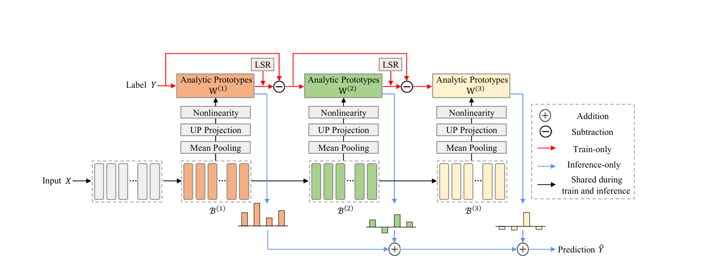

# ReProF: Residual Prototype Fusion for Continual LLM Attribution

<p align="center">
  
</p>

## Introduction

ReProF (**Re**sidual **Pro**totype **F**usion) is a training-free method for continual attribution of LLM-generated text. It addresses the setting in which new source LLMs arrive over time and the system must recognize all previously observed sources without retaining historical samples.

Rather than relying only on the final layer of a frozen feature extractor, ReProF partitions its hidden layers into contiguous blocks, selects informative deep blocks, and constructs analytic prototypes for each block. The prototypes are fitted from shallow to deep: each deeper block models the residual left by preceding blocks. Their cumulative predictions combine complementary stylistic cues while preserving a rehearsal-free continual-learning pipeline.

The implementation supports COT-Bench, which contains human-written text and text generated by 19 LLMs across eight domains: **Abstracts, Books, News, Poetry, Recipes, Reddit, Reviews,** and **Wikipedia**.

## Requirements

### 🗂️ Environment

Experiments were run in the LAMDA environment with one GPU. Install the Python dependencies with:

```bash
pip install -r requirements.txt
```

The pinned environment uses PyTorch 2.1.0, torchvision 0.16.0, and Transformers 4.47.1. The feature extractors are frozen throughout continual learning.

### 🤗 Pre-trained feature extractors

Download the desired checkpoints from Hugging Face before running an experiment. The code supports:

- [Llama-3.2-1B](https://huggingface.co/meta-llama/Llama-3.2-1B)
- [Llama-3-8B-Instruct](https://huggingface.co/meta-llama/Meta-Llama-3-8B-Instruct)
- [Mistral-7B-Instruct-v0.3](https://huggingface.co/mistralai/Mistral-7B-Instruct-v0.3)
- [Qwen2.5-0.5B-Instruct](https://huggingface.co/Qwen/Qwen2.5-0.5B-Instruct)
- [RoBERTa-large](https://huggingface.co/FacebookAI/roberta-large)

Set each local checkpoint path in `MODEL_REGISTRY` in `utils/inc_net.py`. For tokenization, use the corresponding local paths in `utils/data_manager.py` as well.

## 🔎 Dataset

We use [COT-Bench](https://huggingface.co/datasets/sleep24/COT-bench/tree/main), the benchmark for continual origin tracing of LLM-generated text. It can also be downloaded from [Google Drive](https://drive.google.com/drive/folders/195dNDYPBV_dTzelu_foxhDhbVPy6VH-U?usp=drive_link).

After downloading, place the domain folders under `data/COT-Bench/`:

```text
data/
└── COT-Bench/
    ├── abstracts/{train,dev,test}.jsonl
    ├── books/{train,dev,test}.jsonl
    ├── news/{train,dev,test}.jsonl
    ├── poetry/{train,dev,test}.jsonl
    ├── recipes/{train,dev,test}.jsonl
    ├── reddit/{train,dev,test}.jsonl
    ├── reviews/{train,dev,test}.jsonl
    └── wikipedia/{train,dev,test}.jsonl
```

The dataset is not distributed with this repository. Before running, update the `dataset` and `device` fields in the chosen JSON file under `exps/` for your local data path and GPU ID.

## 🔑 Running scripts

The main ReProF configuration is `exps/ReProf.json`. After setting the dataset, checkpoint, and device paths, run:

```bash
python main.py --config exps/ReProf.json
```

For example, to run ReProF on the Abstracts domain, set `dataset` in `exps/ReProf.json` to your local `data/COT-Bench/abstracts` directory, then use the command above.

Other reproducibility configurations are organized as follows:

| Experiment | Configuration directory |
| --- | --- |
| Main result | `exps/ReProf.json` |
| Ablations | `exps/ablation/` |
| Backbone generalization | `exps/generalization/` |
| Number of fused blocks | `exps/fused_blocks/` |
| Projection dimension | `exps/projection_dimension/` |
| Incremental-stage robustness | `exps/robustness/` |
| Random-seed stability | `exps/seed_stability/` |
| Similarity metrics | `exps/similarity_metrics/` |
| Efficiency | `exps/efficiency/` |

Run logs are written to:

```text
logs/{method}/{feature_extractor}/{domain}/{init_cls}-{increment}_{seed}.log
```

Reproduced experiment logs are archived in `results/`.

## 👨‍🏫 Acknowledgment

This implementation builds on [PyCIL](https://github.com/G-U-N/PyCIL) and the continual origin tracing benchmark and codebase from [GLPD](https://github.com/lhr01/continual-origin-tracing). We thank their authors for releasing these resources.

## Citation

If you find this repository useful, please cite:

```bibtex
@inproceedings{wang2026reprof,
  title     = {ReProF: Residual Prototype Fusion for Continual LLM Attribution},
  author    = {Wang, Yujie and Mao, Zhendong and Wang, Quan},
  booktitle = {Proceedings of the 2026 Conference on Empirical Methods in Natural Language Processing},
  year      = {2026}
}
```
